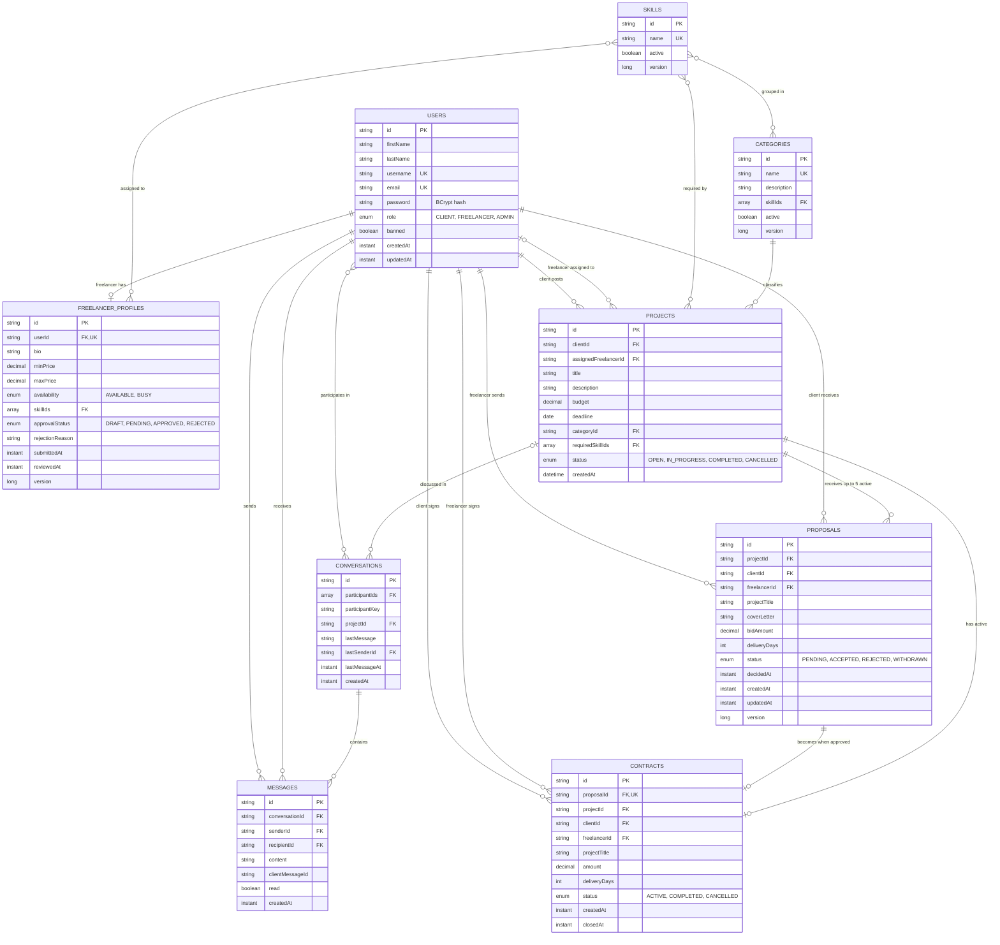

# Database design

Each service owns its own MongoDB database, so these relationships are stored as ids, not database foreign keys. Fields ending in `Ids` are arrays that hold many-to-many relationships.

| Database | Collections | Service |
| --- | --- | --- |
| `identity_db` | `users`, `freelancer_profiles` | `identity-service` |
| `catalog_db` | `skills`, `categories` | `catalog-service` |
| `project_db` | `projects` | `project-service` |
| `proposal_db` | `proposals` | `proposal-service` |
| `contract_db` | `contracts` | `contract-service` |
| `communication_db` | `conversations`, `messages` | `communication-service` |

## Rules the design enforces

| Rule | How |
| --- | --- |
| One profile per freelancer | Unique `userId` |
| One proposal per freelancer on a project | Unique index on `projectId` and `freelancerId` |
| One accepted proposal per project | Partial unique index on `projectId` where status is `ACCEPTED` |
| At most 5 active proposals per project | `ReentrantLock` per project in `proposal-service` |
| One contract per proposal | Unique `proposalId` |
| At most 3 active contracts per freelancer | `ReentrantLock` per freelancer in `contract-service` |
